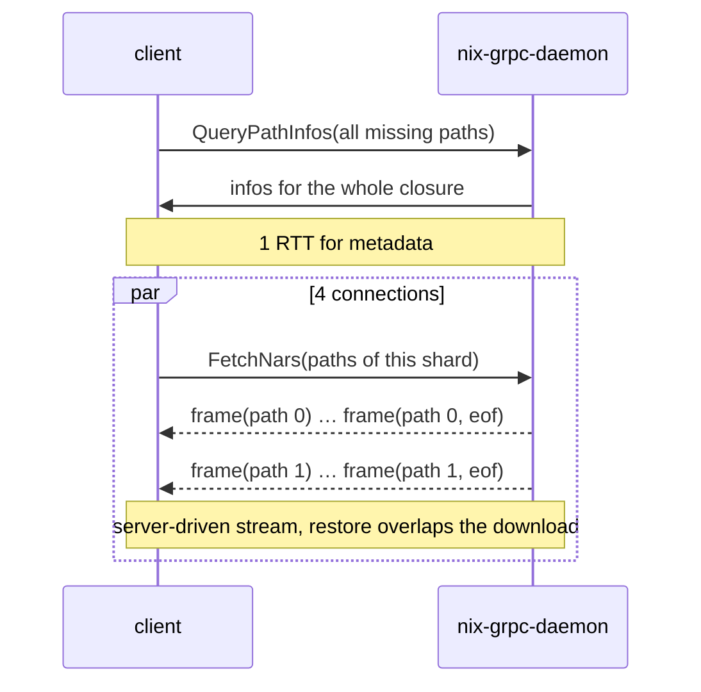
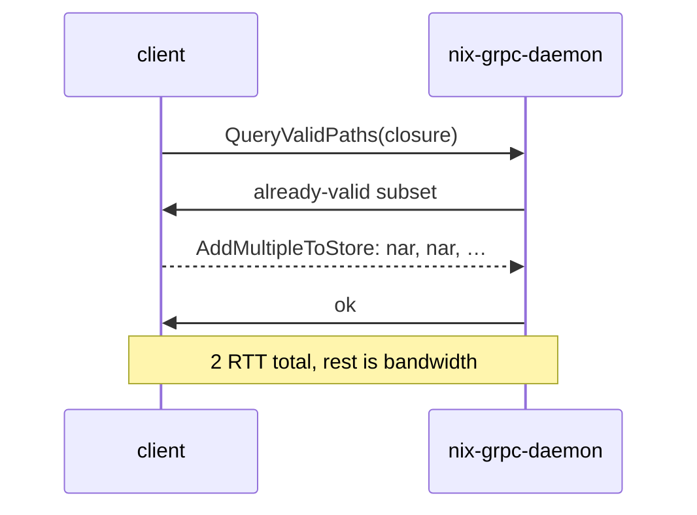
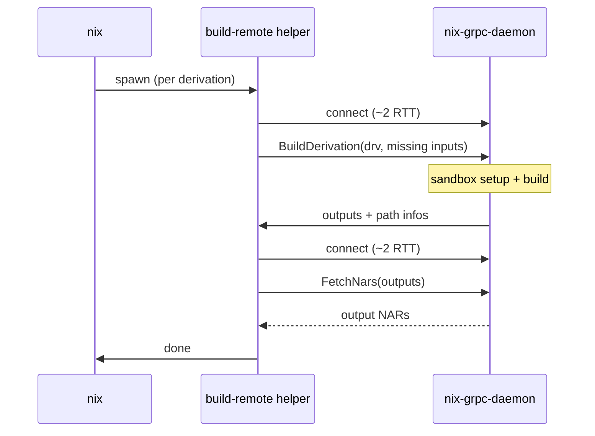
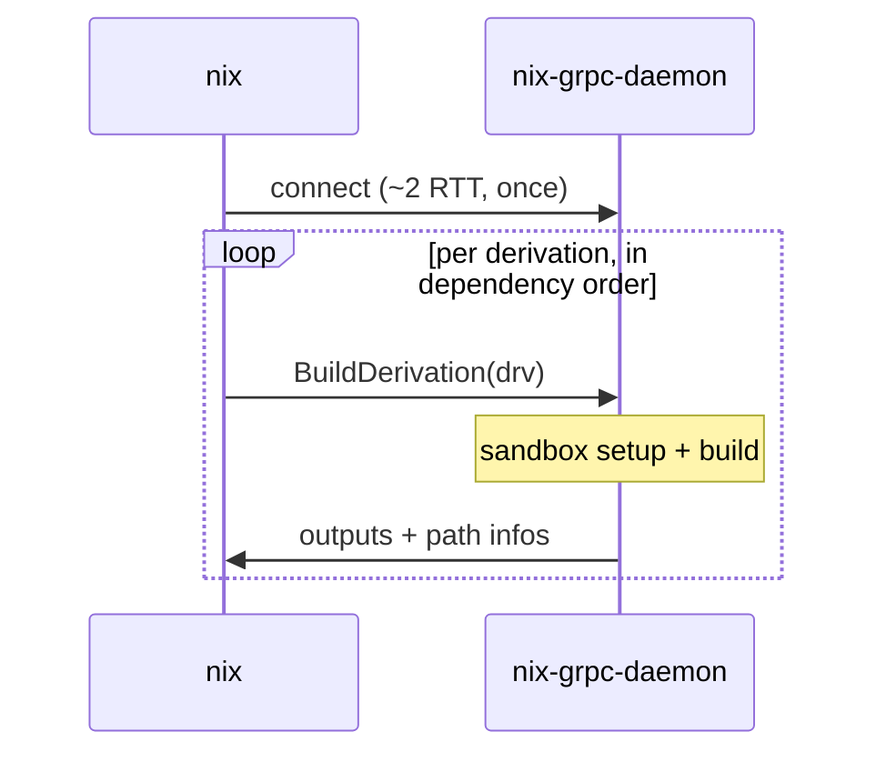

# Protocol latency

Round trips per operation. Every arrow pair that must complete before
the next step costs one RTT (~50 ms on the benchmark link).

A fresh connection costs about 2 RTT (TCP, TLS 1.3, HTTP/2 preface).
Channels are long-lived, so most operations pay this once.

## Substitution (`nix copy --from grpc://…`)

One batched RPC fetches path infos for the whole closure. Downloads
use one `FetchNars` stream per TCP connection (default 4). The client
sends the paths of each shard once and the server streams zstd frames
tagged with a path index. There are no per-path round trips. NARs are
restored while later ones are still in flight.

Total: connection setup + 1 RTT + transfer time. `ssh-ng://` instead
queries and fetches each path in turn over a single channel and pays
round trips per path.

## Upload (`nix copy --to grpc://…`)

One `AddMultipleToStore` stream carries all NARs back to back. The
server answers once at the end.

## Remote build, hook mode (`builders = grpc://…`)

Nix spawns a `build-remote` helper for every derivation. Each helper
opens its own connections, so the connection setup is paid again and
again.

Per derivation: helper spawn + ~4 RTT of connection setup + 2 RPCs +
the build itself. `ssh-ng://` has the same shape. Each connect is a
full ssh session there, and the tunnelled worker protocol adds further
round trips.

## Remote build, direct mode (`nix build --store grpc://…`)

One client process drives the whole build graph over one channel.
There is no helper spawn and no reconnect. Outputs stay on the remote
store instead of being copied back.

Before it builds anything, `nix build` prints what it will build,
fetch and leave unknown (`print-missing`, on by default). It asks the
store's `queryMissing`. Without an evaluation store, or with the
remote store as the evaluation store, that is one `QueryMissing` RPC.
With another evaluation store (`--eval-store auto`, or one the
`eval-store` setting names, on a Nix that passes it to
`queryMissing`), the daemon cannot read the derivations that store
has, so the client runs Nix's own walk over them. The walk of Nix
2.36.0pre20261113_602cd88 asks whether each wanted output is valid one
at a time, and each question is a round trip; a walk that batches
them still asks once per level of the graph. Over a link with a 66 ms
round trip, 400 targets whose outputs were all built took 400
`QueryValidPaths` on that Nix and 65 s, at least 26 s of it in round
trips.

The client therefore asks ahead, in batches, when the walk asks its
first validity question. It goes top down as the walk does: the
targets, then the inputs of the derivations whose wanted outputs the
store lacks and the client's own substituters cannot provide, since
the walk goes below only those. Each call takes one level of the
graph, and the levels under it while they fit in 64 derivations, so
a call may also cover derivations the walk never reaches. The
substituters are asked once per level, as the walk asks them: only
for derivations that allow substitutes. The walk finds their answers in their caches when it asks
them again. The walk's questions are answered from those answers where the batches reached
them, and with a call of their own where not, so the answer is still
Nix's. On that Nix the same 400 targets now take one
`QueryValidPaths`, since all of the roots go in the first call. A
wide graph that neither the store nor the substituters have takes
one call per level, and such a chain of N derivations N/64 calls,
rounded up. A reference of a path the substituters provide is not
asked ahead, so each still costs the walk a round trip, as it did
before.

A target whose derivation the evaluation store does not have, but the
remote store does, is not asked ahead: the walk asks for the
derivation and its outputs itself, as before. A trusted client asks
for the outputs' paths over the `Connect` tunnel; any other client
reads the derivation over NAR fetches, five RPCs a target, where
before it failed. The daemon could answer all such targets in one
`QueryMissing`, but with its own substituters and settings, not the
client's, so the answer would not be Nix's.

Per derivation: 1 RTT + the build itself. What remains is the cost of
the build on the server, not the wire. This is why the transports
converge in this mode.
